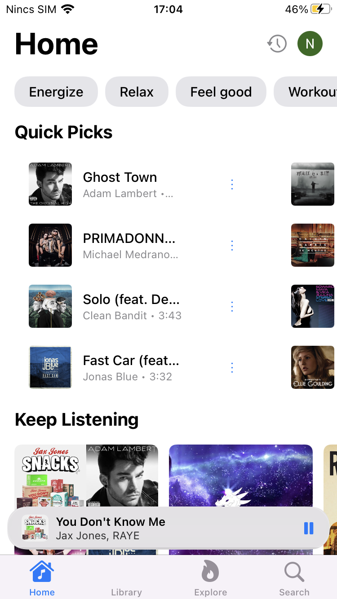
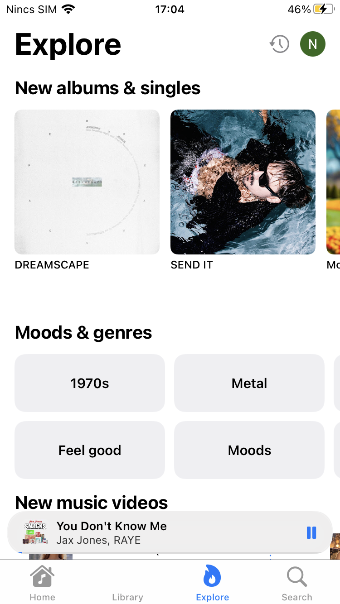
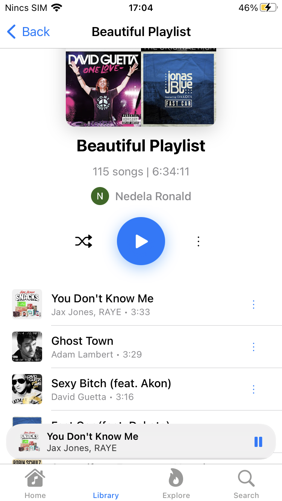
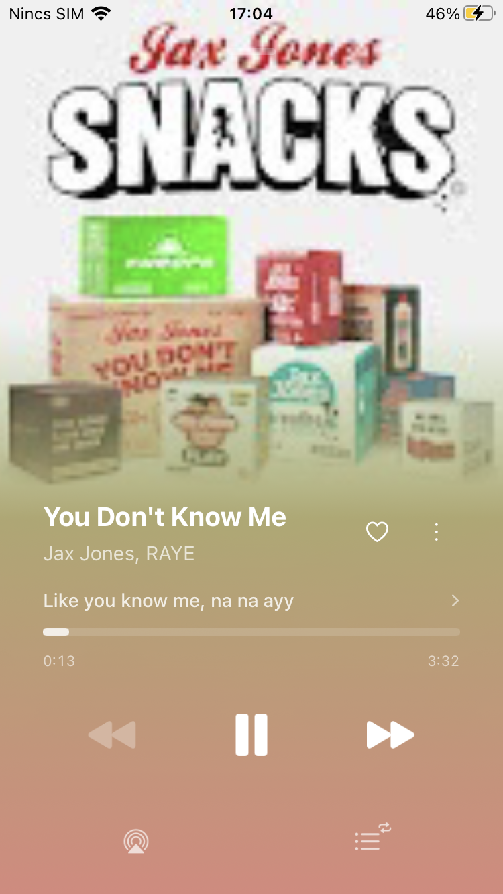

# Trop

A free and open source YouTube Music client for iOS.

<p align="center">
	
	
	
	
</p>

## Features

- **iOS 15.0+ Support**: Fully backported for legacy devices (including iPhone 7 / A10 on iOS 15.8.8) with zero crashes.
- No ads
- SponsorBlock: skips sponsor reads, intros, outros and non-music sections (silence, talking)
- Stream songs and videos from YouTube Music
- Synced lyrics (Musixmatch, Netease, Kugou, LRCLIB, Genius)
- Library sync (playlists, albums, artists, podcasts)
- Downloads & offline playback
- Equalizer
- Custom app icons and themes
- Queue management and listening history
- Google sign-in with Mobile Safari botguard bypass + manual session cookie import fallback

## Installation

Requires iOS 15.0 or later (verified on iOS 15.8.8 / iPhone 7) and a YouTube Music account. Supports TrollStore, SideStore, AltStore, and Feather.

### TrollStore (Recommended for iOS 15.0 - 15.8.8)

1. Download the pre-built unsigned IPA from the [Releases page](https://github.com/RonaldNedela/Trop/releases/latest) or direct link:
   - 📦 **[Trop.ipa (v0.0.4-ios15)](https://github.com/RonaldNedela/Trop/releases/download/v0.0.4-ios15/Trop.ipa)**
2. Open with **TrollStore** to install permanently without revokes or 7-day limits.

### Feather / AltStore / SideStore

Add the Trop source, then install the latest stable release (unsigned - your client re-signs it with your Apple ID):

```
https://raw.githubusercontent.com/SwiftyMedia/Trop/main/altstore.json
```


> **Note:** AltStore PAL is not supported.

Stable releases are available from the [releases page](../../releases). Nightly builds are available in the[Actions](../../actions) tab.

### Manual Installation

 To build an unsigned IPA locally, run `./build_ipa.sh`; the output is `build/Trop.ipa`.

## Notable mentions

- [InnerTubeX](https://github.com/MetrolistGroup/innertubex) - eXtended InnerTube API library for Kotlin
- [zemer-cipher](https://github.com/ZemerTeam/zemer-cipher) - YouTube cipher deobfuscation and PoToken generation
- [Metrolist](https://github.com/MetrolistGroup/Metrolist) - YouTube Music client for Android

## Community

Join the [Discord server](https://discord.gg/QrMwZAfU97) for support and discussion.

## License

This repo is licensed under [GPLv3](LICENSE.txt). Trop is not affiliated with, endorsed, or sponsored by Google or YouTube.
